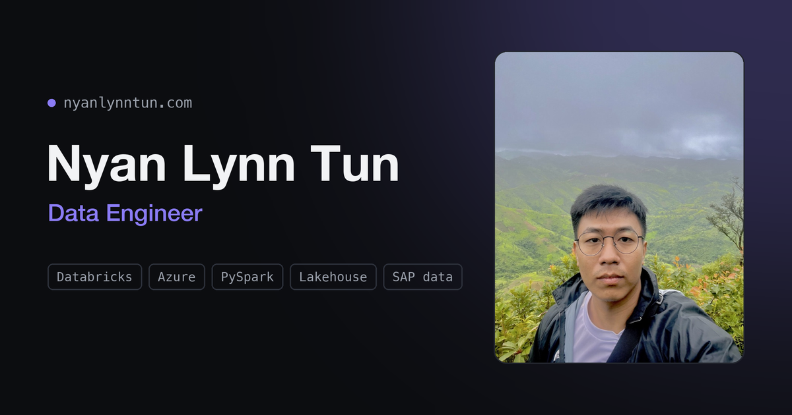

# nyanlynntun.com

[](https://nyanlynntun.com)

The personal site of **Nyan Lynn Tun**, a Bangkok-based data engineer who builds lakehouse platforms, PySpark
pipelines and SAP data integrations on Azure and Databricks.

[](https://nyanlynntun.com)

## What's on the site

- **Experience.** Data engineering in manufacturing (SAP, Azure Databricks data mesh), a
  multi-company retail group's central warehouse, and analytics in banking and retail.
- **Side projects.** Things I build on my own time, such as a medallion e-commerce
  pipeline with [dbt Core on Databricks](https://github.com/plebnyan/dbt_core_databricks)
  and *jobnet-lakehouse*, a lakehouse for the Myanmar job market that is still in progress.
- **What I help with.** Lakehouse architecture, pipelines and dimensional modelling, and getting
  SAP data into a shape the business can report on.
- **About.** Five years of making messy data useful, and why I think the model matters more than
  the platform it runs on.
- **Contact.** Open to data engineering roles and consulting.

## How it's built

I deliberately kept it small. It's one hand-written HTML page with no framework, no build step
and no dependencies.

- **Fast.** The page is about 20 KB of HTML with inline CSS. Images are served as WebP where the
  browser supports it.
- **Light and dark.** It follows your system theme, with a toggle that remembers your choice and
  doesn't flash on load.
- **Accessible.** It uses semantic landmarks, visible keyboard focus, labelled controls and
  screen-reader hints on external links.
- **Discoverable.** It has Open Graph and Twitter cards, `schema.org` Person data, a sitemap and a
  custom 404 page.
- **Private by default.** Analytics run on [GoatCounter](https://www.goatcounter.com), which uses
  no cookies and needs no consent banner. A Content Security Policy blocks every script I haven't
  allowed.
- **Hosted on GitHub Pages.** A GitHub Actions workflow, pinned to exact action versions,
  publishes the `site/` folder on every push to `main`.

```
site/     the published website
brand/    logo concepts, email signature and the scripts that generate images and the CSP
```

## Get in touch

[contact@nyanlynntun.com](mailto:contact@nyanlynntun.com) ·
[LinkedIn](https://www.linkedin.com/in/nyan-lynn-tun-a6aa2a1aa) ·
[GitHub](https://github.com/plebnyan)

---

© Nyan Lynn Tun. The code is here for reference. Please don't reuse the personal content (text,
photo, branding) as your own.
